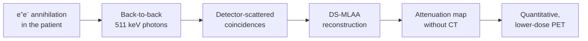

<div align="center">

# Satyam Tiwari

<a href="https://official-satyam-tiwari.github.io/">
  <picture>
    <source media="(prefers-color-scheme: dark)" srcset="https://readme-typing-svg.demolab.com?font=DM+Sans&weight=500&size=22&duration=3200&pause=900&color=6EE7C8&center=true&vCenter=true&width=640&lines=PhD+researcher+in+Biophysics+%40+Jagiellonian+University;CT-less+PET+imaging;Attenuation+maps+from+detector-scattered+coincidences;Monte+Carlo+%C2%B7+Image+Reconstruction+%C2%B7+Deep+Learning">
    
  </picture>
</a>

**J-PET Collaboration · Kraków, Poland**

[](https://official-satyam-tiwari.github.io/)
[](https://orcid.org/0009-0006-2293-3946)
[](https://www.linkedin.com/in/satyam-tiwari-204a3a174/)
[](https://www.researchgate.net/profile/Satyam-Tiwari-35/research)
[](https://official-satyam-tiwari.github.io/cv.pdf)

`16 publications` · `9 conference contributions` · `1 patent pending`

</div>

---

## Research

> **The problem:** PET scanners need an *attenuation map* to produce quantitative images, and that map usually comes from a CT scan, which means extra radiation dose and extra hardware.
>
> **My approach (DSAC):** Detector-scattered coincidences, where a photon scatters inside the detector itself, carry information about the patient's body. I reconstruct the attenuation map from these detector-scattered coincidences, so no CT is needed.



| Research interest | In one line |
|---|---|
| **CT-less PET attenuation correction** | Estimate attenuation maps from detector-scattered coincidences instead of CT |
| **Joint activity and attenuation estimation** | Iterative MLAA-type reconstruction of both at once |
| **Physics-informed AI for PET** | Deep learning to denoise and refine attenuation maps derived from detector-scattered coincidences |

<sub>Supervised by Prof. Paweł Moskal & Dr. Sushil K. Sharma · J-PET group, Jagiellonian University</sub>

---

## Highlights

<details>
<summary><b>Patent pending</b></summary>
<br>

**Generating Attenuation Map from Detector-Scattered Coincidence Events in Positron Emission Tomography**
S. Tiwari, P. Moskal, S. Sharma, E. Stępień
US Patent Application No. 19/859,844 (filed Nov 2026) · Priority: Polish Patent Application P.457524 · Applicant: Jagiellonian University

</details>

<details>
<summary><b>First-author article</b></summary>
<br>

**Feasibility Study of Using Detector-Scattered Photons for Attenuation Correction in CT-less PET Imaging**
S. Tiwari, S. K. Sharma, P. Moskal · *Bio-Algorithms and Med-Systems* 21, 13–20 (2025) · [doi:10.5604/01.3001.0055.4655](https://doi.org/10.5604/01.3001.0055.4655)

</details>

<details>
<summary><b>Selected J-PET collaboration papers (15 in total)</b></summary>
<br>

- **First-in-human quantum entanglement imaging**: *arXiv* (2026) · [link](https://arxiv.org/abs/2606.29421)
- **Monte Carlo-based scatter correction for the plastic-based modular PET scanner J-PET**: *Phys. Med. Biol.* 71, 075026 (2026) · [doi](https://doi.org/10.1088/1361-6560/ae54fb)
- **First positronium lifetime imaging using ⁵²Mn and ⁵⁵Co with a plastic-based PET scanner**: *Scientific Reports* 16, 16230 (2026) · [doi](https://doi.org/10.1038/s41598-026-43965-z)
- **First ex-vivo positronium imaging of tissues with modular J-PET using ⁴⁴Sc**: *Z. Med. Phys.* 36, 357 (2026) · [doi](https://doi.org/10.1016/j.zemedi.2026.03.004)
- **Studies of CPT symmetry in positronium decays with the 192-strip J-PET detector**: *Phys. Rev. D* 113, 032003 (2026) · [doi](https://doi.org/10.1103/wy7r-xgl9)

Full list on the [website](https://official-satyam-tiwari.github.io/#publications).

</details>

<details>
<summary><b>Recent talks and posters</b></summary>
<br>

| When | Where | What |
|---|---|---|
| Nov 2026 | IEEE NSS/MIC, Granada, Spain | DSAC across LYSO vs plastic vs BGO scanners · *Trainee Grant* |
| Sep 2026 | Total-Body PET, UC Davis, USA | CT-less attenuation correction in plastic total-body PET · *Presentation Award* |
| Jul 2026 | 6th Jagiellonian Symposium, Kraków | Analytical modelling of blank scan in DSAC (core organizer) |
| May 2026 | FTMI-TBPET-PSMR, Valencia, Spain | DSAC for cost-effective total-body PET |
| Mar 2026 | EMIM, Slovenia | CT-less attenuation correction via DS-MLAA |

</details>

---

## Toolbox

<div align="center">


</div>

---

## Projects

| Project | What it does |
|---|---|
| **[BiblioAudit](https://github.com/Official-Satyam-Tiwari/Reference-Architect)** · [PyPI](https://pypi.org/project/biblioaudit/) · [DOI](https://doi.org/10.5281/zenodo.18155557) | Catches AI-hallucinated or wrong references in your `.bib` file |
| **[ROOT-Viewer](https://github.com/Official-Satyam-Tiwari/ROOT-Viewer)** | Peek inside ROOT files, fast |
| **[PET System Matrix](https://github.com/Official-Satyam-Tiwari/System-Matrix-Generation-for-PET-Imaging)** | PET reconstruction from scratch |
| **[Monte Carlo playground](https://github.com/Official-Satyam-Tiwari/MC_Codes)** | Randomness, but make it physics |
| **[Physics simulations](https://github.com/Official-Satyam-Tiwari/Advanced_Mathematical_Physics_Simulations)** | Equations brought to life |

```bash
pip install biblioaudit   # try it on your next paper's references
```

---

## Quick quiz: test your PET intuition

<details>
<summary><b>Q1. Why do PET photons come out back-to-back?</b></summary>
<br>
When a positron annihilates with an electron (almost at rest), momentum conservation sends two 511 keV photons in nearly opposite directions. The line joining the two detections is the <i>line of response</i>.
</details>

<details>
<summary><b>Q2. Why does PET usually need a CT scan?</b></summary>
<br>
Photons get absorbed or scattered on the way out of the body. To correct for this you need an attenuation map, which normally comes from CT. My work obtains it from detector-scattered coincidences in the PET data itself.
</details>

<details>
<summary><b>Q3. How many ⁴⁰K decays happen in your body every second?</b></summary>
<br>
About <b>4,000–5,000 per second</b>. You are mildly radioactive, and that's completely normal. My website keeps a live counter.
</details>

---

## GitHub at a glance

<div align="center">
  <picture>
    <source media="(prefers-color-scheme: dark)" srcset="https://github-profile-summary-cards.vercel.app/api/cards/stats?username=Official-Satyam-Tiwari&theme=github_dark">
    
  </picture>
  <picture>
    <source media="(prefers-color-scheme: dark)" srcset="https://github-profile-summary-cards.vercel.app/api/cards/repos-per-language?username=Official-Satyam-Tiwari&theme=github_dark">
    
  </picture>
</div>

---

## Let's collaborate

<table>
<tr>
<td valign="top" width="50%">

**I bring**
- Image reconstruction
- Attenuation correction
- Monte Carlo · GATE
- Deep learning

</td>
<td valign="top" width="50%">

**I want to learn**
- Scintillators
- SiPM readout
- Timing · TOF
- Detector characterisation

</td>
</tr>
</table>

**Next up: PET detector instrumentation.** Working on detectors? Reach me at [satyam.tiwari@doctoral.uj.edu.pl](mailto:satyam.tiwari@doctoral.uj.edu.pl).

<div align="center">
<sub>Off the clock: table tennis · AIR 15 in IIT JAM Physics · Presented in 4 countries</sub>
</div>
